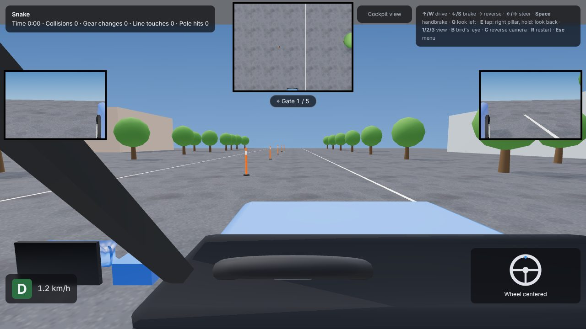
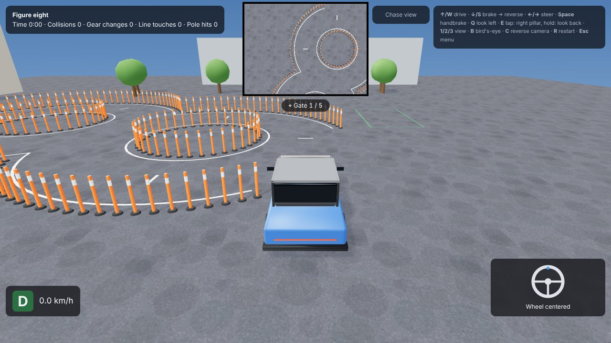
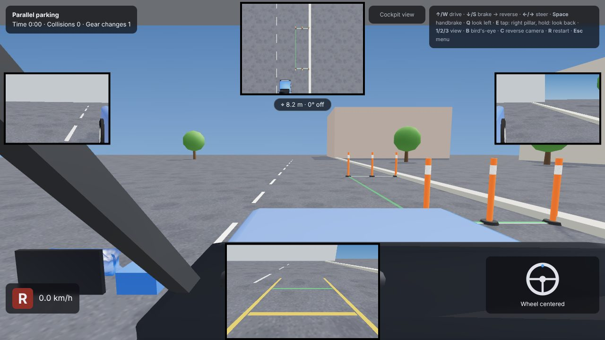
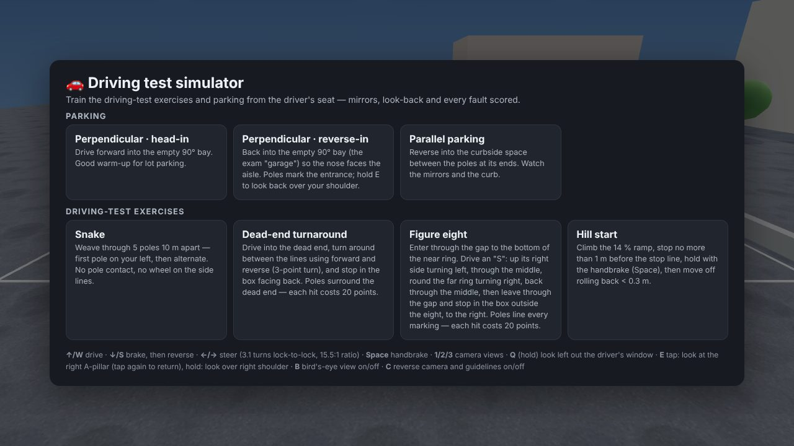

# 🚗 Driving test simulator

**Practise the driving-test exercises and parking in your browser, from the driver's seat.**

### ▶️ [Play now: a1llexander.github.io/Driving-test-simulator](https://a1llexander.github.io/Driving-test-simulator/)

No install, no sign-up. Works in any modern browser on a computer, and on phones and tablets with on-screen controls.

## What you can practise

**Driving-test exercises** (modelled on the autodrome part of the Georgian practical exam):

| Exercise | Task |
| --- | --- |
| **Snake** | Weave through 5 poles 10 m apart without touching a pole or a side line. |
| **Dead-end turnaround** | Turn around in a dead end with forward and reverse (3-point turn) and stop in the box facing back. |
| **Figure eight** | Drive an "S" round two rings, then leave through the gap and stop in the finish box. |
| **Hill start** | Stop no more than 1 m before the stop line on a 14 % ramp, hold with the handbrake, move off rolling back less than 0.3 m. |

**Parking:** perpendicular head-in, perpendicular reverse-in (the exam "garage") and parallel parking.

## Why it feels like a real car

- **You drive from the cockpit.** You see what you would see from the driver's seat, with working door mirrors.
- **You can turn your head.** Look out of the driver's window, at the right A-pillar, or back over your shoulder, as you do when reversing in the exam.
- **The steering wheel matches a real car:** 3.1 turns lock to lock. Reference points you learn here, like "turn when the pole reaches the mirror", carry over to the real thing.
- **Reverse camera.** Its guidelines curve with the steering wheel. You can switch it off to practise exam conditions.
- **Bird's-eye inset.** It shows the next gate or the parking bay. You can switch it off too.

## Scoring

Every run starts at **100 points** and loses points for each fault: a pole hit or collision (−20), a wheel on a line (−10), a missed or badly placed hill stop, rolling back on the hill, extra gear changes and going over the time limit. At the end you get a breakdown of every deduction and a grade:

**S** ≥ 95 · **A** ≥ 85 · **B** ≥ 70 · **C** ≥ 50 · **F** below 50

## Controls

| Key | Action |
| --- | --- |
| `↑` / `W` | Drive |
| `↓` / `S` | Brake; once stopped, reverse |
| `←` / `→` or `A` / `D` | Turn the steering wheel |
| `Space` | Handbrake (holds the car on the hill) |
| `Q` (hold) | Look left out of the driver's window |
| `E` | Tap: look at the right A-pillar · Hold: look back over your right shoulder |
| `1` / `2` / `3` | Cockpit / chase / top-down camera |
| `B` | Bird's-eye inset on/off |
| `C` | Reverse camera and guidelines on/off |
| `R` | Restart the exercise |
| `Esc` | Back to the menu |

On a phone or tablet, the pedals, steering and look buttons appear on screen.

## Good to know

- The real exam course dimensions aren't published, so the distances here are close approximations. Treat the simulator as practice for technique, not as an exact copy of the test site.
- The simulator is a training aid. It doesn't replace lessons with an instructor.
- Your settings (bird's-eye, reverse camera) are saved in your browser. No account is needed, and no personal data is collected. Anonymous visit statistics are kept with [GoatCounter](https://www.goatcounter.com/), which uses no cookies.

## Feedback

Found a bug, or something that doesn't match the real exam? [Open an issue](https://github.com/A1llexander/Driving-test-simulator/issues). Please say what happened, on which exercise, and which device and browser you used.

---

## 🇷🇺 Коротко по-русски

**Тренажёр экзаменационных упражнений и парковки прямо в браузере.** [**Играть**](https://a1llexander.github.io/Driving-test-simulator/). Ничего не нужно устанавливать или регистрировать, работает на компьютере и на телефоне.

- **Упражнения автодрома:** змейка, разворот в тупике, восьмёрка, старт на подъёме. Упражнения сделаны по мотивам практического экзамена в Грузии.
- **Парковка:** передом и задом в «гараж», параллельная.
- **Как в машине:** вид из-за руля, зеркала, повороты головы (`Q` — влево, `E` — вправо и назад), руль как у реальной машины, камера заднего вида.
- **Оценка:** каждая попытка начинается со 100 баллов. Стойка или столкновение −20, колесо на линии −10, плюс штрафы за откат на подъёме, лишние переключения и время. Итоговые оценки: S / A / B / C / F.

Точные размеры экзаменационной площадки не публикуются, поэтому они здесь приближённые. Тренажёр помогает отработать технику, но не заменяет занятия с инструктором.
